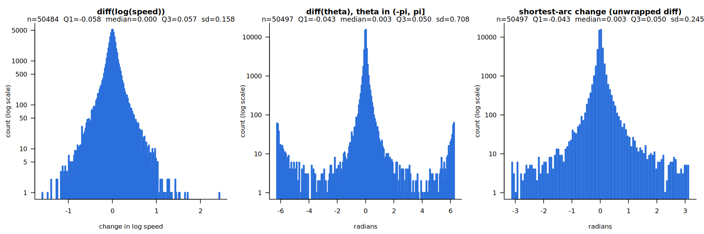

# Experiment 1: point forecasts of wind with complex ARIMA

Status as of 2026-09-30 (runs 1–4). Everything below comes from the scripts in `R/` and the tables in
`results/tables/`; the commands to reproduce it are at the end.

## 1. Aim

The paper argues that wind should be modelled as **one complex variable** (speed and direction
together) with complex ARIMA (cARIMA), rather than as two real series. Experiment 1 is the first
test of this: rolling-origin point forecasts of 10-minute wind, from 10 minutes to 6 hours ahead,
comparing cARIMA with persistence and with pairs of independent real ARIMA models.

## 2. Data

- Kaggle Wind Turbine SCADA dataset, file `T1.csv`: one turbine in Turkey, 2018, 10-minute
  resolution, wind speed (m/s) and wind direction (degrees). Details in `data/README.md`.
- 50,530 rows on a 52,560-slot grid (2,030 missing slots, three gaps longer than 3 days).
- `R/02_prepare_data.R`:
  - puts the data on a regular 10-minute grid;
  - fills gaps of at most 36 slots (6 hours) by linear interpolation of the real and imaginary parts
    of Z (defined below);
  - replaces speeds below 0.1 m/s (10 exact zeros) by 0.1, so that logs exist;
  - an origin is **eligible** if its 4-week training window has no missing values and its 6-hour
    horizon has no missing values and no values from interpolations longer than 3 slots.
- The first eligible window (2018-01-30 14:40 to 2018-02-27 14:30) is the **selection window**.
  300 test origins are spread evenly over the later eligible origins (2018-02-27 14:40 to
  2018-12-31 17:50; none in October, because of gaps).

## 3. How the wind is modelled

### 3.1 Wind as a complex number

With speed v_t and direction angle θ_t,

    Z_t = v_t · exp(i θ_t) = v_t cos θ_t + i · v_t sin θ_t.

The real and imaginary parts are the plain Cartesian coordinates of the wind vector (not the
meteorological zonal/meridional components). The angle is kept in (−π, π].

### 3.2 Complex ARIMA

cARIMA(p, d, q) is the ARIMA model with all variables and parameters complex:

    (1 − φ1 B − … − φp B^p)(1 − B)^d y_t = β0 + (1 + θ1 B + … + θq B^q) ε_t.

It is fitted with `complex::clm()` (and `complex::auto.carima()` for order selection in run 4),
by maximum likelihood.

Why this is interesting: multiplying by a complex coefficient φ = r·exp(iα) **scales by r and
rotates by α**. As a bivariate model for (Re, Im), each complex coefficient is a 2×2 real matrix
with the restricted form [[a, −b], [b, a]]. So cARIMA is a restricted VARIMA with 2 real parameters
per lag instead of 4. This parsimony against VAR is the central argument of the paper.

The error ε_t is **complex normal** with a variance and a **pseudo-variance**. A non-zero
pseudo-variance means the error is non-circular: the scatter of errors is an ellipse, not a
circle. For wind this corresponds to anisotropy, i.e. a prevailing direction of the changes. In
the tables below, the non-circularity index |E e²| / E|e|² is 0 for circular errors and 1 for
errors lying on a line.

### 3.3 Why logs

The main target is the complex logarithm

    log Z_t = log v_t + i θ_t.

- It **separates speed and direction**: the real part is log speed, the imaginary part is the
  angle. A cARIMA on log Z is still one complex model, with the two parts linked through the
  complex coefficients and the error covariance.
- Speed changes are roughly **multiplicative** (a gust changes speed by a percentage, and changes
  are larger when it is windy), so log speed is a more natural scale than speed.
- Forecasts back-transformed with exp() give a **positive speed** and a valid angle automatically.
- Note: exp() of a forecast of log Z is not the mean forecast of Z; this experiment does not
  correct for that.

The models on Z itself (no logs) are kept for comparison.

### 3.4 Why differences (d = 1), and angle unwrapping

- 10-minute wind is very persistent: over a 4-week window the level wanders without a stable mean,
  and persistence is a hard benchmark. We therefore model **changes**, d = 1, for all models in
  runs 1–3. With logs, the differences are log speed ratios and angle changes, which have a clear
  meaning.
- The angle in (−π, π] jumps by about 2π whenever the wind crosses the cut (696 times in T1.csv).
  In the differences these jumps would be huge artificial shocks. So within each training window
  the angle is **unwrapped** (cumulative sum of the shortest-arc changes); its differences are then
  the true angle changes. Forecasts are wrapped back to (−π, π] for evaluation.
- `clm()` works in the "direct" form: forecasts come out in levels and different d are comparable
  by information criteria.
- In run 4, `auto.carima()` is allowed to choose d ∈ {0, 1}. It picks **d = 0 for Z** (with AR
  coefficient ≈ 0.993–0.994, a half-life of about 100–120 steps ≈ 16–20 hours), and d = 1 for log Z.



### 3.5 Why the complex generalised normal distribution

The 10-minute changes have very heavy tails. Kurtosis of the consecutive 10-minute changes in
T1.csv (normal = 3):

| change | kurtosis |
|---|---|
| log speed | 14.4 |
| angle (shortest arc) | 52.8 |
| Re Z | 131.9 |
| Im Z | 25.5 |

About 3% of angle changes exceed 30° and 0.5% exceed 90°. Under a normal likelihood these
outliers pull the estimates, in particular the constant (drift), which for log Z is a steady
**rotation** of the forecasts: 0.0122 rad per step in `carima_logZ`, i.e. 25° over the 6-hour
horizon. (The project notes for run 2 record a median rotation of 17° at h36 for the normal model
and 5° with the generalised normal; this was not recomputed here.)

So we added a **complex generalised normal** likelihood (`distribution = "dcgnorm"` in `clm()`;
Novey, Adali & Roy, 2010). For the error e = z − μ, with scale α², pseudo-scale ψ² and shape β,

    f(z) ∝ exp(−½ Q^β),   Q = 2(α²|e|² − Re(conj(ψ²) e²)) / (α⁴ − |ψ²|²).

Shape β = 1 is the complex normal; β < 1 gives heavier tails (β = 0.5 is Laplace-like). The shape
is estimated; scale and pseudo-scale are concentrated out in closed form. The estimated shapes
are about **0.21 for log Z and 0.41 for Z**, far from normal, and the generalised normal raises
the log-likelihood by about 5,000 (log Z) and 1,500 (Z) on the selection window.

## 4. Experimental design

Pipeline: `R/02_prepare_data.R` → `R/03_select_orders.R` → `R/04_rolling_origin.R` →
`R/05_evaluate.R` (shared code in `R/functions.R`; parameter table from `R/06_parameters.R`).

- **Rolling origin:** 300 origins, window of 4 weeks (4,032 observations), horizons h = 1..36
  (10 minutes to 6 hours). Parameters are re-estimated at every origin.
- **Order selection:** once, on the selection window; orders are then fixed for all origins.
  - cARIMA models of runs 1–3: d = 1, p and q in 0..3 by AICc. `clm()` can end in a poor local
    optimum from its default start, so each fit also starts from the estimates of the nested
    models (p−1, q) and (p, q−1) and keeps the best log-likelihood (`fitCARIMA()`).
  - auto.carima models (run 4): `auto.carima(y, orders = list(ar = 3, i = 1, ma = 3),
    constant = NULL)`, stepwise search: it chooses p, q, **d and the constant**.
  - Real benchmarks: `forecast::auto.arima` with d = 1; `smooth::auto.msarima` on diff(y), then
    refitted with i = 1.
  - At each origin, cARIMA fits start from the default and from the selection-window estimates.
- **Evaluation:** RMSE by horizon in original units:
  - speed: |Ẑ| − |Z| (m/s);
  - angle: Arg(Ẑ) − Arg(Z) wrapped to (−180°, 180°];
  - vector: |Ẑ − Z| (m/s), the length of the wind vector error.

### Models

| model | series | distribution | orders | constant |
|---|---|---|---|---|
| `persistence` | – | – | last observed Z | – |
| `carima_logZ` | log Z | normal | d = 1, AICc | yes |
| `carima_logZ_cgn` | log Z | generalised normal | d = 1, AICc | yes |
| `carima_logZ_nd` | log Z | normal | d = 1, AICc | no |
| `carima_logZ_cgn_nd` | log Z | generalised normal | d = 1, AICc | no |
| `carima_z` | Z | normal | d = 1, AICc | yes |
| `carima_z_cgn` | Z | generalised normal | d = 1, AICc | yes |
| `auto_carima_logZ` | log Z | normal | auto.carima | auto |
| `auto_carima_logZ_cgn` | log Z | generalised normal | auto.carima | auto |
| `auto_carima_z` | Z | normal | auto.carima | auto |
| `auto_carima_z_cgn` | Z | generalised normal | auto.carima | auto |
| `arima_*`, `msarima_*` | two real series | normal | auto.arima / auto.msarima, d = 1 | selected |

The real benchmarks forecast two series independently and combine them into Z:
(speed, angle), (log speed, angle) and (Re, Im).

History: run 1 = cARIMA with a constant and the real benchmarks; run 2 = generalised normal;
run 3 = log Z without a constant (`_nd`); run 4 = auto.carima.

## 5. Selected orders and estimated parameters

Estimates on the selection window (`results/tables/parameters_carima.csv`,
`R/06_parameters.R`). In the rolling origin they are re-estimated at every origin. The MA sign
convention is (1 + θ1 B + …). Standard errors are not reported: `summary()` on these fits fails
in the current package version (the `vcov` refit cannot find `distribution`).

| model | (p,d,q) | constant | AR | MA | shape | logLik |
|---|---|---|---|---|---|---|
| `carima_logZ` | (0,1,3) | -0.0003+0.0122i | – | -0.0856-0.0148i, -0.0511-0.0018i, -0.0250+0.0011i | – | 493.33 |
| `carima_logZ_cgn` | (0,1,2) | 0.0001+0.0012i | – | 0.0607+0.0056i, -0.0649+0.0047i | 0.212 | 5510.52 |
| `carima_z` | (0,1,2) | -0.0026-0.0005i | – | -0.0281-0.0245i, -0.1250+0.0375i | – | -9906.10 |
| `carima_z_cgn` | (0,1,2) | -0.0016+0.0088i | – | 0.0306+0.0023i, -0.1000+0.0250i | 0.408 | -8420.80 |
| `carima_logZ_nd` | (1,1,2) | none | 0.6264-0.0111i | -0.7074+0.0000i, 0.0000+0.0000i | – | 492.51 |
| `carima_logZ_cgn_nd` | (0,1,2) | none | – | 0.0650+0.0089i, -0.0774+0.0131i | 0.212 | 5509.75 |
| `auto_carima_z` | (1,0,2) | -0.0159+0.0138i | 0.9930+0.0022i | -0.0270-0.0287i, -0.1293+0.0394i | – | -9888.61 |
| `auto_carima_z_cgn` | (1,0,2) | -0.0102+0.0212i | 0.9943+0.0006i | 0.0344+0.0010i, -0.0918+0.0197i | 0.409 | -8408.73 |
| `auto_carima_logZ` | (1,1,1) | 0.0000+0.0044i | 0.6427+0.0044i | -0.7250-0.0145i | – | 499.72 |
| `auto_carima_logZ_cgn` | (0,1,2) | none | – | 0.0685+0.0017i, -0.0710+0.0003i | 0.213 | 5509.95 |

Notes:

- **Constants.** For log Z, the imaginary part of the constant is the angle drift per 10 minutes:
  0.0122 rad (0.70°) for `carima_logZ`, the same value as the drift of the real `arima_angle`
  model (0.0121). The generalised normal shrinks it to 0.0012. auto.carima keeps a constant for
  log Z with the normal distribution and drops it with the generalised normal.
- **Z with d = 0.** φ1 ≈ 0.993–0.994 with an almost zero argument: close to a unit root, without
  rotation. The implied long-run mean is β0 / (1 − φ1): −2.63 + 1.14i (normal) and
  −2.16 + 3.49i (generalised normal), i.e. vectors of 2.9 and 4.1 m/s. For comparison, the
  mean *speed* in the window is 8.5 m/s, but the mean *vector* is only 3.5 m/s long, because
  winds from different directions cancel. Mean reversion therefore shrinks |Ẑ| at long horizons.
- `auto_carima_logZ_cgn` selected (0,1,2) without a constant, the same specification as
  `carima_logZ_cgn_nd`.
- **Caveat, `carima_logZ_nd`.** On refitting, (1,1,2) reaches logLik 492.51, above the 489.91
  found during order selection (`carima_order_grid.csv`), and the best fit has θ2 = 0 exactly,
  which suggests the optimiser stayed at the start padded from the nested (1,1,1) model. The order selection for this model
  therefore used a sub-optimal fit, and (1,1,1) may have been the better choice. All other models
  reproduce the selection log-likelihood (differences below 0.02).

**Residual covariance** of (Re, Im) on the selection window. The non-circularity of about 0.27–0.33
means clearly elliptical errors, i.e. a prevailing direction of change, which a pair of
independent real models ignores.

| model | sd Re | sd Im | cor(Re, Im) | non-circularity |
|---|---|---|---|---|
| `carima_logZ` | 0.196 | 0.265 | -0.076 | 0.304 |
| `carima_logZ_cgn` | 0.201 | 0.264 | -0.054 | 0.271 |
| `carima_z` | 0.901 | 0.798 | 0.310 | 0.330 |
| `carima_z_cgn` | 0.904 | 0.800 | 0.311 | 0.332 |
| `carima_logZ_nd` | 0.195 | 0.265 | -0.075 | 0.306 |
| `carima_logZ_cgn_nd` | 0.201 | 0.264 | -0.051 | 0.269 |
| `auto_carima_z` | 0.900 | 0.796 | 0.310 | 0.331 |
| `auto_carima_z_cgn` | 0.903 | 0.799 | 0.313 | 0.334 |
| `auto_carima_logZ` | 0.195 | 0.266 | -0.075 | 0.306 |
| `auto_carima_logZ_cgn` | 0.201 | 0.264 | -0.053 | 0.269 |

**Real benchmarks** (`results/tables/parameters_benchmarks.csv`):

| model | (p,d,q) | drift/constant | coefficients |
|---|---|---|---|
| `arima_speed` | (5,1,3) | FALSE | ar1=-0.5156, ar2=0.1343, ar3=0.7397, ar4=0.0330, ar5=0.0443, ma1=0.4364, ma2=-0.2834, ma3=-0.7965 |
| `msarima_speed` | (3,1,2) | TRUE | phi1[1]=0.3978, phi2[1]=0.2726, phi3[1]=0.0589, theta1[1]=-0.4786, theta2[1]=-0.3482, drift=-0.0002 |
| `arima_logSpeed` | (1,1,2) | FALSE | ar1=0.7313, ma1=-0.9495, ma2=0.0767 |
| `msarima_logSpeed` | (3,1,3) | TRUE | phi1[1]=0.2165, phi2[1]=0.1815, phi3[1]=0.1305, theta1[1]=-0.4353, theta2[1]=-0.2192, theta3[1]=-0.1209, drift=-0.0001 |
| `arima_angle` | (2,1,0) | TRUE | ar1=0.0346, ar2=-0.0267, drift=0.0121 |
| `msarima_angle` | (0,1,1) | TRUE | theta1[1]=0.0355, drift=0.0121 |
| `arima_re` | (2,1,1) | FALSE | ar1=-0.3312, ar2=-0.1251, ma1=0.2956 |
| `msarima_re` | (0,1,2) | TRUE | theta1[1]=-0.0360, theta2[1]=-0.1247, drift=-0.0022 |
| `arima_im` | (2,1,2) | FALSE | ar1=0.1092, ar2=-0.0453, ma1=-0.1265, ma2=-0.1186 |
| `msarima_im` | (0,1,2) | TRUE | theta1[1]=-0.0196, theta2[1]=-0.1664, drift=-0.0004 |

## 6. Results

RMSE by horizon over the 300 origins (`results/tables/rmse_{speed,angle,z}.csv`; all 36 horizons
are in the files). Bold = best in the column. No model failed at any origin.

### Speed |Z| (m/s)

| model | h1 | h3 | h6 | h12 | h24 | h36 | h1-36 |
|---|---|---|---|---|---|---|---|
| `persistence` | 0.710 | 1.048 | 1.571 | 1.995 | 2.607 | 3.082 | 2.282 |
| `carima_logZ` | 0.715 | 1.061 | 1.575 | 2.000 | 2.602 | 3.085 | 2.283 |
| `carima_logZ_cgn` | **0.706** | 1.047 | 1.575 | 2.014 | 2.634 | 3.129 | 2.309 |
| `carima_logZ_nd` | 0.714 | 1.058 | 1.576 | 1.996 | 2.593 | 3.071 | 2.276 |
| `carima_logZ_cgn_nd` | 0.706 | **1.045** | 1.569 | 1.991 | 2.609 | 3.083 | 2.284 |
| `carima_z` | 0.718 | 1.055 | 1.569 | 1.989 | 2.598 | 3.080 | 2.281 |
| `carima_z_cgn` | 0.716 | 1.054 | 1.574 | 1.999 | 2.613 | 3.093 | 2.294 |
| `auto_carima_logZ` | 0.715 | 1.067 | 1.582 | 2.013 | 2.637 | 3.178 | 2.321 |
| `auto_carima_logZ_cgn` | 0.707 | 1.047 | 1.570 | 1.992 | 2.608 | 3.083 | 2.284 |
| `auto_carima_z` | 0.726 | 1.083 | 1.615 | 2.105 | 2.818 | 3.354 | 2.466 |
| `auto_carima_z_cgn` | 0.720 | 1.062 | 1.584 | 2.031 | 2.690 | 3.183 | 2.352 |
| `arima_logSpeed_angle` | 0.727 | 1.083 | 1.598 | 2.014 | 2.586 | 3.023 | 2.271 |
| `arima_re_im` | 0.727 | 1.054 | 1.569 | 1.978 | 2.576 | 3.044 | 2.256 |
| `arima_speed_angle` | 0.720 | 1.047 | **1.557** | **1.951** | **2.500** | **2.981** | **2.214** |
| `msarima_logSpeed_angle` | 0.728 | 1.087 | 1.607 | 2.022 | 2.596 | 3.049 | 2.283 |
| `msarima_re_im` | 0.728 | 1.061 | 1.574 | 1.996 | 2.603 | 3.085 | 2.283 |
| `msarima_speed_angle` | 0.717 | 1.051 | 1.567 | 1.976 | 2.557 | 3.033 | 2.247 |

### Angle (degrees)

| model | h1 | h3 | h6 | h12 | h24 | h36 | h1-36 |
|---|---|---|---|---|---|---|---|
| `persistence` | 12.42 | 20.74 | 26.78 | 36.49 | 43.01 | 46.14 | 38.59 |
| `carima_logZ` | 12.67 | 20.71 | 26.73 | 36.99 | 45.42 | 49.47 | 40.18 |
| `carima_logZ_cgn` | 12.50 | 20.88 | 26.82 | 36.57 | 43.41 | 46.31 | 38.74 |
| `carima_logZ_nd` | 12.64 | **20.44** | **26.29** | **36.14** | 42.63 | **45.77** | **38.21** |
| `carima_logZ_cgn_nd` | 12.46 | 20.90 | 26.84 | 36.60 | 43.02 | 46.13 | 38.62 |
| `carima_z` | 12.81 | 20.96 | 26.82 | 36.53 | 42.82 | 45.94 | 38.50 |
| `carima_z_cgn` | 12.66 | 21.00 | 26.96 | 36.27 | **42.57** | 46.10 | 38.40 |
| `auto_carima_logZ` | 12.52 | 20.83 | 27.04 | 37.24 | 45.58 | 49.57 | 40.29 |
| `auto_carima_logZ_cgn` | 12.48 | 20.87 | 26.82 | 36.55 | 42.99 | 46.12 | 38.59 |
| `auto_carima_z` | 12.98 | 21.47 | 27.64 | 36.63 | 44.31 | 48.28 | 39.80 |
| `auto_carima_z_cgn` | 12.68 | 21.13 | 27.13 | 36.43 | 43.02 | 46.80 | 38.75 |
| `arima_logSpeed_angle` | 12.49 | 21.09 | 27.15 | 37.27 | 45.64 | 49.42 | 40.38 |
| `arima_re_im` | 12.87 | 21.14 | 27.06 | 36.75 | 42.60 | 45.84 | 38.57 |
| `arima_speed_angle` | 12.49 | 21.09 | 27.15 | 37.27 | 45.64 | 49.42 | 40.38 |
| `msarima_logSpeed_angle` | **12.38** | 21.15 | 27.29 | 37.27 | 45.68 | 49.43 | 40.40 |
| `msarima_re_im` | 12.74 | 20.85 | 26.78 | 36.58 | 42.94 | 45.99 | 38.56 |
| `msarima_speed_angle` | **12.38** | 21.15 | 27.29 | 37.27 | 45.68 | 49.43 | 40.40 |

### Wind vector |Z − Ẑ| (m/s)

| model | h1 | h3 | h6 | h12 | h24 | h36 | h1-36 |
|---|---|---|---|---|---|---|---|
| `persistence` | 0.960 | 1.634 | 2.307 | 2.996 | 4.104 | 4.721 | 3.567 |
| `carima_logZ` | 0.965 | 1.658 | 2.363 | 3.139 | 4.507 | 5.385 | 3.915 |
| `carima_logZ_cgn` | **0.955** | **1.620** | 2.298 | 2.998 | 4.126 | 4.763 | 3.584 |
| `carima_logZ_nd` | 0.961 | 1.631 | 2.297 | 2.991 | 4.078 | 4.700 | 3.550 |
| `carima_logZ_cgn_nd` | 0.955 | 1.620 | 2.294 | 2.981 | 4.093 | 4.710 | 3.555 |
| `carima_z` | 0.964 | 1.630 | 2.296 | 2.979 | 4.077 | 4.699 | 3.549 |
| `carima_z_cgn` | 0.963 | 1.635 | 2.306 | 2.984 | 4.091 | 4.715 | 3.560 |
| `auto_carima_logZ` | 0.965 | 1.676 | 2.388 | 3.186 | 4.580 | 5.535 | 3.987 |
| `auto_carima_logZ_cgn` | 0.955 | 1.622 | 2.296 | 2.983 | 4.093 | 4.711 | 3.556 |
| `auto_carima_z` | 0.967 | 1.633 | 2.307 | 2.985 | 4.030 | 4.587 | 3.509 |
| `auto_carima_z_cgn` | 0.964 | 1.634 | 2.299 | **2.946** | **3.977** | **4.501** | **3.455** |
| `arima_logSpeed_angle` | 0.971 | 1.684 | 2.390 | 3.150 | 4.488 | 5.360 | 3.909 |
| `arima_re_im` | 0.974 | 1.631 | **2.294** | 2.969 | 4.045 | 4.648 | 3.522 |
| `arima_speed_angle` | 0.968 | 1.669 | 2.374 | 3.132 | 4.468 | 5.360 | 3.900 |
| `msarima_logSpeed_angle` | 0.973 | 1.693 | 2.406 | 3.162 | 4.500 | 5.380 | 3.923 |
| `msarima_re_im` | 0.973 | 1.645 | 2.309 | 2.995 | 4.098 | 4.723 | 3.567 |
| `msarima_speed_angle` | 0.965 | 1.673 | 2.378 | 3.132 | 4.480 | 5.365 | 3.901 |

## 7. Findings

1. **No model beats persistence on all three measures.** Gains over persistence are small, at most
   about 3% at h1–36 (vector: 3.455 vs 3.567), as expected for 10-minute wind with no exogenous
   information; badly specified models lose up to about 10%.
2. **Short horizons (h1–h3):** cARIMA on log Z with the generalised normal (`carima_logZ_cgn`,
   `carima_logZ_cgn_nd`) is best for the vector error and speed.
3. **Drift rotates forecasts.** With a normal likelihood, a constant on log Z is a steady rotation
   of the direction; `carima_logZ` and `auto_carima_logZ` are among the worst for angle (≈ 40° vs
   38.6° for persistence at h1–36) and vector error. Removing the constant (`carima_logZ_nd`)
   gives the **best angle of all models** (38.21°), and the generalised normal largely removes the
   problem even with a constant.
4. **Z with d = 0 (run 4):** `auto_carima_z_cgn` has the **best vector error of all models** at
   h1–36 (3.455 vs 3.567 persistence and 3.522 for the best real pair, `arima_re_im`), coming from
   h12 onwards. It pays in speed (2.352 vs 2.282), because it reverts to the short mean wind
   vector. `auto_carima_z` (normal) does the same with a worse speed (2.466, the worst).
5. **Speed alone** is best forecast by the real `arima_speed_angle` at h6 and beyond (2.214),
   which models speed directly.
6. **Heavy tails are real:** shape ≈ 0.2 (log Z) and 0.4 (Z), and the generalised normal helps
   most where the normal model's drift was hurting.

## 8. Limitations and next steps

- Point forecasts only; no predictive distributions, no statistical tests (e.g. Diebold–Mariano),
  no MAE or relative measures yet.
- One turbine, one year; orders selected on a single February window and fixed for the year.
- The exp() back-transform of log Z forecasts is not bias-corrected.
- The order selection for `carima_logZ_nd` used a sub-optimal fit (section 5).
- Not yet: diurnal / Fourier terms, VAR / VARMA benchmarks (the parsimony argument needs them),
  power forecasts, other datasets.

## 9. Reproduce

```sh
Rscript R/02_prepare_data.R            # needs data/raw/T1.csv (see data/README.md)
Rscript R/03_select_orders.R [model …] # no arguments = all models
Rscript R/04_rolling_origin.R [model …]
Rscript R/05_evaluate.R
Rscript R/06_parameters.R
```

`03` and `04` merge their results into the existing ones by model name. Run 4 (four auto.carima
models) took 23 minutes for order selection and 2.8 hours for the rolling origin on 4 cores.
